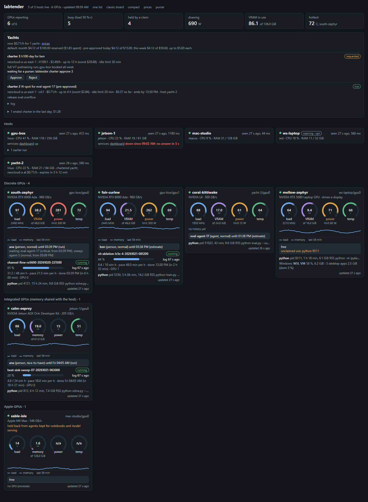
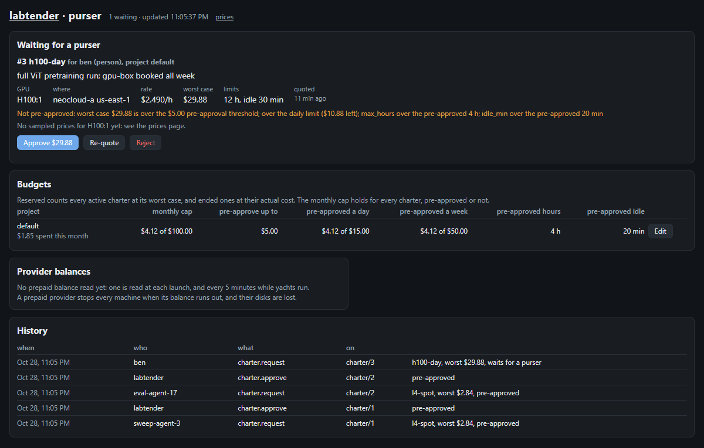

# labtender

A lab board and GPU ledger for a small lab shared by people and AI agents, with budget-capped
cloud GPUs for when the lab is full.



Small research labs end up with a mixed fleet: a workstation or two under WSL2, an NVIDIA Jetson,
a Mac Studio, a laptop with a good GPU, and now and then a rented cloud GPU. Several people and a
growing number of AI coding agents run long jobs on them. labtender answers the questions that
come up every day: what is running where, who is using that GPU and until when, who is waiting
for it, and is it worth renting another one.

## What it does

- **Shows the whole fleet without installing anything.** The labtender service reaches each node
  over plain `ssh` and pipes a small standard-library probe to `python3`; nothing is left behind.
  NVIDIA GPUs through `nvidia-smi`, Jetson through sysfs and `tegrastats`, Apple silicon through
  `ioreg` (no sudo), and WSL2 processes placed on their GPU from `CUDA_VISIBLE_DEVICES`, which
  `nvidia-smi` cannot do under WSL.
- **Keeps a ledger of who holds each GPU.** Claims with priority tiers, queues with expected start
  times, leases kept alive by heartbeats or by binding a claim to a run, and flags for unclaimed
  use, idle claims and unpinned processes. Claims are advisory: labtender never starts, stops or
  pre-empts work on a lab machine.
- **Treats agents as lab members.** Each agent session gets its own token and the same ledger as
  MCP tools, so an agent checks the board, queues for a GPU and releases it like a person would.
  `labtender preflight` gives run wrappers a single go or no-go.
- **Follows runs from their own logs.** Pluggable parser specs turn a job's log folder into
  progress, a wall rate and an estimated finish, without changing the job.
- **Charters cloud GPUs under a budget.** When the lab is full, a charter rents a cloud GPU
  through [SkyPilot](https://github.com/skypilot-org/skypilot) (Google Cloud, RunPod, Lambda and
  others), joins it to the board as an ordinary host, runs set-up, copies results back and
  destroys it. Every charter reserves its worst case against a monthly cap. Agents may approve
  small charters themselves, within per-charter, daily and weekly limits; anything larger waits for
  a person with the `purser` role. A reaper ends idle yachts, and a hard time limit set on the
  cloud side ends them even if labtender is down.



## Try it in a minute

The demo seeds a fictional lab, so you need no hosts and no cloud account:

```bash
git clone https://github.com/lhzn-io/labtender && cd labtender
LABTENDER_HOME=/tmp/labtender-demo uv run python scripts/demo_state.py
LABTENDER_HOME=/tmp/labtender-demo uv run labtender serve --no-collect
```

Then open <http://127.0.0.1:8795/>, `/compact`, `/prices` and `/purser`.

## Use it on your lab

```bash
uv tool install -e .                  # or: uv venv && uv pip install -e ".[dev]"
labtender host add gpu-box            # an ~/.ssh/config alias
labtender host add workstation --local
labtender watch add gpu-box run-wrapper '~/runs/*/'
labtender serve                       # http://127.0.0.1:8795/
```

`labtender status` prints the same view as text, and `labtender probe <host>` polls one host now.

Claims go through the labtender service with a token, one per person or agent session
(`labtender token create <name> --kind agent`):

```bash
export LABTENDER_TOKEN=...
labtender claim gpu-box/gpu0 --hours 6 --note "parameter sweep"
labtender claims gpu-box/gpu0         # holder, estimated return, queue, flags
labtender bind 12 '~/runs/sweep-01/'  # the run keeps the claim alive
labtender preflight 0 8 --claim       # in a run wrapper: exit 0 means go
```

Agent sessions get the ledger and charters as MCP tools:

```bash
claude mcp add labtender -e LABTENDER_TOKEN=... -- labtender mcp
```

Cloud GPUs need SkyPilot installed beside labtender, a provider account set up for it, and a
charter profile; see the [yachts guide](docs/src/yachts.md).

## What it is not

labtender is not a scheduler or a cluster manager. It does not queue jobs for you or enforce
claims; it records who intends to use what, shows everyone, and flags what does not match. If your
lab is large and uniform enough for Slurm or Kubernetes, use those. labtender is for the lab that
is too small or too mixed for them.

## Status

Pre-alpha, in daily use in one lab across WSL2 workstations, two Jetsons, a Mac Studio, and cloud
charters on Google Cloud and RunPod. Interfaces may still change; see the
[status page](docs/src/status.md) and [CONTRIBUTING.md](CONTRIBUTING.md).

## Words

The lab is the marina, and each GPU or host is a slip. Cloud GPUs are expensive yachts, chartered
by the hour; labtender is the tender that runs work out to them and brings results back. The
purser keeps the money.

## Documentation

Getting started, reading the board, following runs, the claim ledger, agent sessions, cloud GPUs,
the CLI and HTTP references, and safety are under [`docs/src/`](docs/src/). Build them with
`uv pip install -e ".[docs]"` and `sphinx-build -b html docs/src docs/build/html`.

## Licence

Apache-2.0. Copyright 2026 Long Horizon Observatory.
