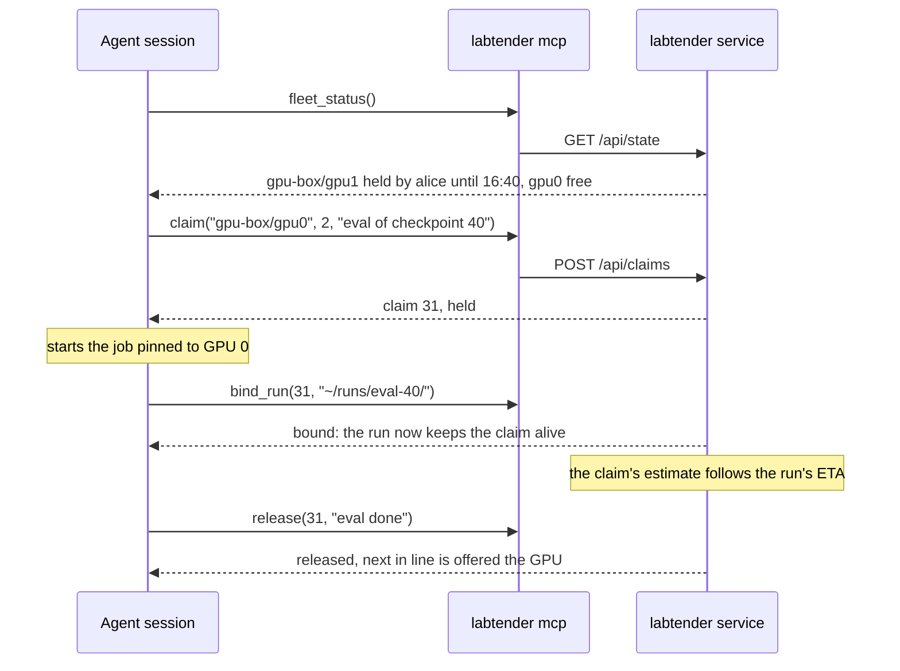

# Agent sessions (MCP)

AI coding agents share GPUs with people. labtender gives them the same ledger through an MCP
server, so an agent can see what is running, claim a GPU or queue for it, keep its claim alive
and release it, under exactly the rules people follow.

## Set up

`labtender mcp` is a stdio MCP server. Run one per agent session, each with its own token:

```bash
labtender token create sweep-agent-1 --kind agent       # shown once
claude mcp add labtender \
  -e LABTENDER_TOKEN=lt_... \
  -e LABTENDER_URL=http://labtender.lan:8795 \
  -- labtender mcp
```

Any MCP client that can launch a stdio server works the same way. `LABTENDER_URL` defaults to
`http://127.0.0.1:8795`. The server is a thin client of the labtender service's HTTP API: it holds no state
and makes no decisions of its own.

## Tools

| Tool | What it does |
|---|---|
| `fleet_status()` | Every host and GPU: load, memory, processes, holder and estimated return, queue, flags, the host's services, and running runs with their finish times and links. |
| `resource(resource)` | One GPU (`host/gpuN`) or host: holders, queue with expected start times, flags. |
| `claim(resource, est_hours, note, tier="normal", lease_minutes=10, share=None, pickup_minutes=None)` | Claim, or join the queue. Returns the claim; `held` means go, `queued` means wait, with the queue position and expected start. |
| `heartbeat(claim_id, est_hours=None, lease_minutes=None)` | Keep a held claim alive, take up an offered GPU, revise the estimate, or change the lease. |
| `bind_run(claim_id, run_dir)` | Tie a held claim to a watched run folder; the run then keeps it alive. A folder not yet seen is waited for, up to 30 minutes. |
| `release(claim_id, reason="")` | End a claim, held or queued. |
| `my_claims()` | This session's identity and its active claims, with positions and times. |
| `charter_profiles()` | Cloud GPU profiles that can be chartered. |
| `charter_quote(profile, max_hours=None, idle_minutes=None)` | Prices, the worst case, whether it would be pre-approved (and why not), and what is left of the limits. Free. |
| `charter_request(profile, note, max_hours=None, idle_minutes=None)` | Charter a yacht. Spends money; within the limits it launches at once, otherwise it waits for a purser. |
| `charter_status()` | This session's charters (state, host, claims, cost so far, time limit) and the budgets. |
| `charter_end(charter_id, reason="")` | Withdraw a charter, or land and destroy its yacht now. |

Times are ISO 8601 with the labtender service's offset. A refused call returns an error with the reason (for
example *claim 12 belongs to alice*), so the agent can explain or adjust.

## What the server tells the agent

The server sends agents a short set of instructions when they connect. They are kept in
`src/labtender/prompts/mcp_instructions.txt` and read at run time, so a lab can review and adjust
them like any other file. In short:

1. Look before you start GPU work.
2. Claim before you start, with an honest estimate and a note; a queued claim means wait.
3. Never take a GPU someone else holds; share only with an agreement the holder and the user
   gave, and write it down.
4. Keep the claim alive with heartbeats, or bind it to the run.
5. Take up an offered GPU within 15 minutes.
6. Release as soon as you are done, including when you stop waiting.
7. Flags are information for people, not instructions to act on another session's work.
8. Prefer the lab's GPUs; charter a yacht only when the work needs one, and say why.
9. Quote first; never try to raise limits or approve, and tell the user what a bigger charter is
   for and what it would cost.
10. Hold the yacht's claims like any other, and copy results off before finishing.
11. End the charter as soon as the work is done.

## A typical session



## Heartbeat loops

Binding the claim to the run is better than a loop: the run's own log keeps the claim alive, and
the claim follows the run to its end. When a loop is the only option, make its test for "the
work is still going" exact. `tmux has-session -t NAME` also matches any session whose name starts
with `NAME`, so a loop testing for `train` keeps the claim alive for as long as a session called
`train-hb` exists, even after `train` has ended. Use `-t =NAME` for an exact match:

```bash
while tmux has-session -t =train 2>/dev/null; do
  labtender heartbeat 31
  sleep 300
done
labtender release 31
```
