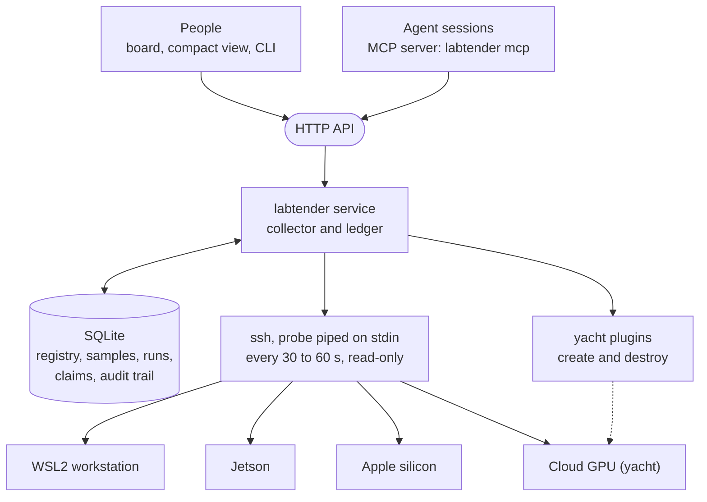

# labtender

```{raw} html
<div class="lt-hero">
  <a class="lt-repo" href="https://github.com/lhzn-io/labtender" title="labtender on GitHub">
    <svg viewBox="0 0 16 16" aria-hidden="true"><path fill-rule="evenodd" d="M8 0C3.58 0 0 3.58 0 8c0 3.54 2.29 6.53 5.47 7.59.4.07.55-.17.55-.38 0-.19-.01-.82-.01-1.49-2.01.37-2.53-.49-2.69-.94-.09-.23-.48-.94-.82-1.13-.28-.15-.68-.52-.01-.53.63-.01 1.08.58 1.23.82.72 1.21 1.87.87 2.33.66.07-.52.28-.87.51-1.07-1.78-.2-3.64-.89-3.64-3.95 0-.87.31-1.59.82-2.15-.08-.2-.36-1.02.08-2.12 0 0 .67-.21 2.2.82.64-.18 1.32-.27 2-.27.68 0 1.36.09 2 .27 1.53-1.04 2.2-.82 2.2-.82.44 1.1.16 1.92.08 2.12.51.56.82 1.27.82 2.15 0 3.07-1.87 3.75-3.65 3.95.29.25.54.73.54 1.48 0 1.07-.01 1.93-.01 2.2 0 .21.15.46.55.38A8.013 8.013 0 0016 8c0-4.42-3.58-8-8-8z"></path></svg>
    <span>lhzn-io/<strong>labtender</strong></span>
  </a>
  <p class="lt-tagline">Tender loving care for a shared GPU lab.</p>
</div>
```

labtender is a small board and GPU claim ledger for labs whose compute is a mix of machines:
workstations running WSL2, NVIDIA Jetsons, Apple silicon, and the occasional cloud GPU. People
and AI coding agents share those machines. labtender shows everyone what each machine is doing,
who holds each GPU, who is waiting for it, and when it should free.

It has four jobs:

1. **Know the fleet.** A registry of hosts, static or ephemeral (with an expiry), added and
   removed from the CLI or the API.
2. **See the fleet without installing anything on it.** GPU, CPU and run progress are collected
   over plain SSH by a small probe piped to the node's own `python3`. Nothing stays on the node.
3. **Share the fleet fairly.** A fleet-wide ledger of claims, with a queue per GPU, heartbeats,
   estimated return times and reconciliation against what is actually running. People use the
   board and CLI; agents use the same rules through MCP tools.
4. **Grow and shrink the fleet in the cloud.** Short-lived cloud GPUs (*yachts*) chartered by
   the hour, under budgets, pre-approval limits and a reaper that the core enforces.

```{figure} _static/board.png
:alt: The labtender board with four hosts, their GPUs, claims, queues and running jobs
:width: 100%

The board for a fictional lab: two RTX GPUs with their holders and a queue, a Jetson taking
low-priority work, a Mac Studio, and a laptop flagged for GPU use without a claim.
```

## How it fits together



The labtender service is one process. It polls each registered host, follows the progress of long runs from
their own log files, keeps the claim ledger, and serves the board, the HTTP API and the data the
MCP server needs.

## Where to start

- New here: [](getting-started.md), then [](board.md).
- Sharing GPUs: [](ledger.md); for agent sessions, [](agents.md).
- Cloud GPUs and budgets: [](yachts.md).
- Your own run format: [](runs.md).
- How it works and what it promises: [](architecture.md), [](safety.md).

## The words

The lab is the **marina**; each GPU or host is a **slip**. A **claim** reserves a slip, and a
**queue** forms when it is taken. Cloud GPUs are expensive **yachts**, chartered by the hour, and
labtender is the **tender** that runs work out to them and brings results back.

```{toctree}
:caption: Using labtender
:maxdepth: 2
:hidden:

getting-started
service
board
runs
ledger
yachts
agents
sign-in
```

```{toctree}
:caption: Reference
:maxdepth: 2
:hidden:

cli
http-api
architecture
safety
status
```
