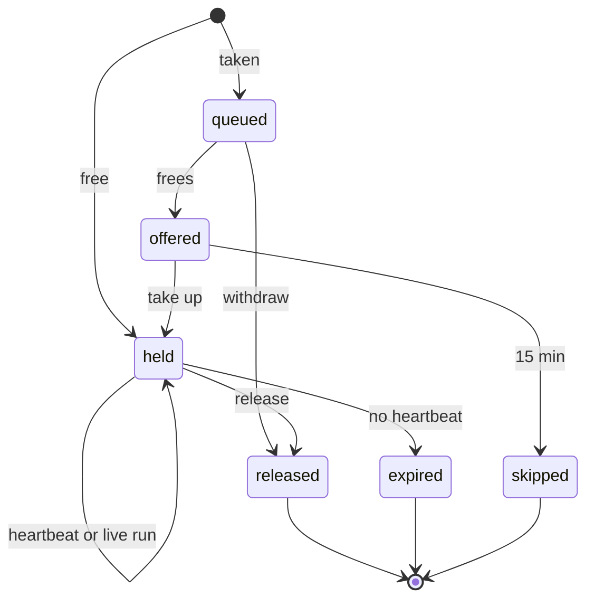

# The claim ledger

The ledger records who holds each GPU, who is waiting for it, and when it should free. It is
**advisory**: labtender never starts, stops, pins or kills anyone's work. It keeps the queue,
estimates return times, and compares claims with what the probe sees, so people and agents can
share GPUs without stepping on each other.

## Resources

A resource is a GPU, written `host/gpuN` with the `nvidia-smi` index (`gpu-box/gpu1`), or a
whole host (`mac-studio`) for machines shared as one unit. Claims on a GPU are checked against
the GPUs the host last reported.

## Life of a claim



| Rule | Behaviour |
|---|---|
| Claim | Held at once if the resource has no holder and nobody waiting; otherwise queued. Claiming again returns your existing claim. |
| Queue | First in, first out within tiers: `critical`, then `normal`, then `nice-to-have`. A higher tier moves up the queue but never displaces a holder. |
| Host tiers | A host can take only some tiers (`labtender host set slow-box --accepts nice-to-have`); other claims are refused. |
| Offer | When a resource frees, the head of the queue is offered it and has its pickup window (15 min by default, `--pickup-min` up to 24 h) to take it up, by claiming again or sending a heartbeat. Otherwise the offer is skipped and passes on. Unattended job chains should ask for a longer window. |
| Lease | A held claim needs a heartbeat within its lease (10 min by default, `--lease-min` on the claim, changed later with `heartbeat --lease-min`). Past the lease the board marks it late; past twice the lease it expires and the next in line is offered the GPU. |
| Bound run | `labtender bind <claim> <run folder>` ties a claim to a watched run. While the run is running it keeps the claim alive, so a long run outlives the session that started it, and the run's ETA becomes the claim's estimated return. A wrapper may bind as soon as it starts the run: a folder no probe has seen yet is waited for (up to 30 minutes, the claim kept alive meanwhile) and attached when it appears; if it never does, the ordinary lease resumes. |
| Sharing | A second holder needs `--share "<who agreed and why>"`. The agreement is recorded on the claim and in the audit trail. |
| Release | Only the owner ends a claim. A person (not an agent) can end someone else's with `--force` and a reason, which is audited. |
| Paused claims | While a claim's host stops answering (asleep, travelling, down) or its GPU is missing from the host's probes (an external GPU unplugged), its lease and any offer are paused instead of running out. The board shows "paused: host unreachable" or "paused: GPU missing", and the clock restarts when the host or GPU returns. You can still queue for a GPU that is away. |
| Departed hosts | Claims on a host that leaves the registry expire. |
| Cards that move | labtender follows each GPU by its own id (its UUID), not only by host and index. When a card turns up on another host, or at another index after it is plugged back in, the move is recorded (`card.moved` in the audit trail) and claims made for it at its old place expire with "the card moved to ...": whatever ran on it there has ended. A moved card is not reported missing, and a new claim for its old place is refused with where it went. Each card gets a two-word name made from its UUID (for example `brisk-heron`), the same wherever it is plugged in and in any lab, shown on the board with the start of its UUID; `labtender card name host/gpu1 egpu` renames it, and leaving out the name gives its own back. A GPU with no UUID (an Apple GPU) is a card by its place. |
| Cards held back from agents | `labtender card hold CARD "slow for long jobs"` keeps agents off a card: a claim on it from an agent token is refused with the reason, while people can still claim it, and an agent already holding or queued for it keeps its place. `labtender card offer CARD` lifts the hold. Use it for a GPU that is slow for the lab's usual work, drives a display, or is kept for something else, so an agent picking a free GPU from the board does not land there. Both are audited (`card.set`). |

## Estimated return

For each held claim the labtender service takes the later of two estimates:

- the bound run's estimated finish, while the run is running;
- the claimant's own `--hours` from when the claim was held, scaled by how their past estimates
  turned out: the median of actual over estimated hold time across their last ten finished
  claims, once there are at least three, kept between 0.5 and 3.

So a claim that covers a chain of runs, bound to the first, still shows when the whole chain
should end: revise it with `labtender heartbeat <id> --hours N` as the chain goes on, and rebind
the claim to each run as it starts. With neither estimate, the board says so.

A GPU frees at the latest estimated end of its holders. The queue's expected start times chain
from there, each waiting claim adding its own (scaled) estimate.

## Reconciliation

After every probe, and at once whenever a claim on a host is made, bound, released, expired or
skipped (using that host's last probe), the labtender service compares claims with what is on each GPU and
raises or clears flags:
*unclaimed use*, *idle claim* and *unpinned* (see [](board.md)). Flags are shown on the board and
audited. They exist so people notice; nothing acts on them automatically.

## Preflight for run wrappers

`labtender preflight` lets a job wrapper check a GPU before it starts. It looks at the GPU
locally first, from `/proc` (because `nvidia-smi` under WSL lists no processes) and the GPU's
free memory, then asks the ledger:

```bash
labtender preflight 1 8 --claim --hours 6 --note "sweep 3 of 10"
```

| Exit | Meaning |
|---|---|
| 0 | Go: the GPU is free and has the memory, and (when the labtender service answers) you hold it. |
| 2 | The GPU or `nvidia-smi` is missing. |
| 3 | Another process occupies the GPU, or a GPU process is not pinned to one GPU. |
| 4 | The GPU is short of memory (skipped on unified-memory devices). |
| 5 | The ledger says the GPU is not yours: someone else holds it, or you are queued. |

With `--claim` it claims the GPU (or joins its queue) first. If the labtender service cannot be reached it
falls back to the local check and says so, so a wrapper keeps working when the labtender service is down.
`--ignore TEXT` leaves out shared services whose command line contains `TEXT`.

## Identities and tokens

Every change is made as the identity of a bearer token. Create one per person and one per agent
session, so the board and the audit trail say who did what:

```bash
labtender token create alice --kind person
labtender token create review-bot-0412 --kind agent
labtender token revoke review-bot-0412
```

Tokens are shown once; the labtender service stores only their SHA-256 hash. Each token has roles: `viewer`,
`operator` (claims) and `admin` (the host registry). A person gets all three by default, an
agent `viewer` and `operator`:

```bash
labtender token create intern-01 --kind person --role viewer
```

Other services can check a token with `GET /api/whoami`, which returns its identity, kind and
roles, so one set of identities can guard the board, the ledger and tools built beside them.
