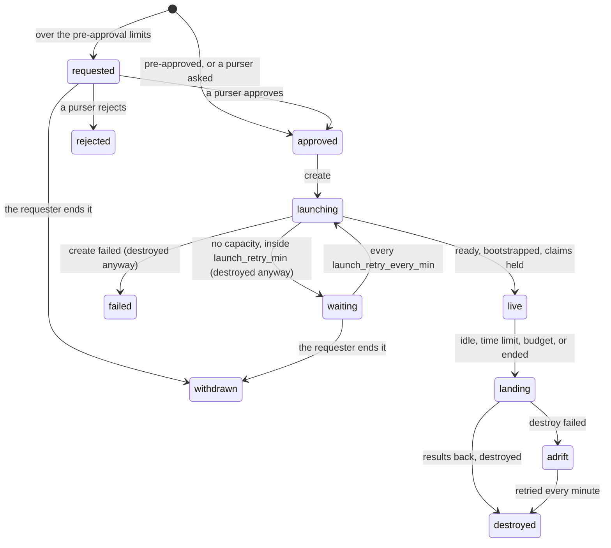

# Cloud GPUs (yachts)

When the lab's own GPUs are busy, or the work needs hardware the lab lacks, labtender can
charter a cloud GPU by the hour: a **yacht**. A charter is created on approval, joins the board
and the ledger like any host, and is landed and destroyed when it goes idle, reaches its time
limit or hits the budget, with its cost shown throughout.

Money is the point of this page. labtender's core owns every decision that spends it; the
plugins that talk to clouds only do what the core tells them.

## The rules

| Rule | What it means |
|---|---|
| Worst case | A charter is priced at its worst case, the hourly rate times its time limit (`max_hours`). That amount is reserved when the charter is approved. When the yacht is destroyed, the reservation is replaced by what it actually cost. |
| Monthly cap | No charter is approved, by anyone, if the project's reserved spend for the calendar month plus its worst case would pass the monthly cap (default $100). If actual spend ever reaches the cap, every live yacht in the project is reaped. |
| Pre-approval | A charter is approved at once, with nobody asked, when its worst case is within the per-charter threshold (default $5), it fits the rolling daily and weekly limits for pre-approved spend (defaults $15 and $50), and its time and idle limits are short (at most 4 h and 20 min by default). Agents and people both get this. |
| Purser approval | Anything bigger waits, with the reasons shown, for a person holding the `purser` role, who approves or rejects it on the board or with the CLI. |
| Pursers | `purser` is never a default role. It is granted by name (`labtender token grant dana purser`) and only to people; the service refuses it for agent tokens. Only pursers change limits. |

A charter draws on the project its profile names. Only a purser may name another project in a
request, since a name labtender has not seen starts with the default limits, and letting anyone
choose one would give pre-approval no ceiling.

The limits are per project and modelled on usage limits: an agent can see what it has left today
and this week (`labtender budget ls`, or the MCP `charter_quote` and `charter_status` tools), and
when it runs out, requests go to a person instead of failing silently.

## Life of a charter



Once live, the yacht is a host named `yacht-<id>`: the board shows its GPUs, processes and runs,
watches the run folders its profile names, and the requester holds a claim on each of its
GPUs. labtender heartbeats those claims itself while the charter is live, so the requester need
not: the yacht is already paid for. A claim bound to a run is left to the run. Releasing them tells the reaper the work is done, and the yacht counts as idle.

## The reaper

Two independent layers make sure an idle yacht stops billing.

1. **labtender's reaper** checks every live yacht every 15 s. It lands and destroys one when:
   - nobody has held a claim on it, or its GPUs have been idle, for its idle limit. Idle means
     no watched run is running, and every GPU is under 5 % load with under 512 MiB of memory
     in use. Processes that merely load the CUDA library do not count: cloud images run
     daemons that do (SkyPilot's runtime among them) without using the GPU. A finished run
     therefore starts the idle clock at once, even while its claim is still held;
   - its work writes the profile's `done_file` on the yacht (looked for every minute; its
     content, if any, is taken as an exit status, and anything but `0` shows in the end reason as
     `work done, exit N`). With a `done_file`, the idle limit only catches work that crashed
     without writing it;
   - it nears its time limit: landing starts early enough for the land commands
     (`land_timeout_min`) and the destroy (5 minutes) to finish inside `max_hours`, so the actual
     cost stays within the reserved worst case. The lead is never more than half the charter;
   - its project's actual spend reaches the monthly cap;
   - its requester or a purser ends it.

   Landing runs the profile's land commands (results back) with a timeout. If they fail while
   the provider still reports the yacht up, landing is retried a minute later, up to three
   times and never within 10 minutes of the time limit; then the yacht is destroyed anyway and
   the failure is recorded. An unbounded bill is worse than a lost result, so copy results off
   as you go with `sync` (below).

   Every 5 minutes the reaper also asks the provider whether each live yacht still exists. One
   reported gone or stopped (seen twice for any other state) is **lost**: its meter stops at
   that moment, it is torn down without landing, and `charter.lost` is audited. Providers stop
   machines on their own when a prepaid balance runs out, and a stopped machine's disk is gone.
2. **The provider's own timer.** At create, the plugin arranges for the machine to be destroyed
   after `max_hours` on the provider's side, so a yacht dies on time even if the labtender
   service is down. The SkyPilot plugin sets `autostop` with `down=True` and
   `wait_for="none"` in the launch itself, a hard limit, and refuses the yacht if SkyPilot does
   not report it set. SkyPilot's idle autostop is not used for this: it counts SkyPilot jobs and open SSH
   sessions, so it would destroy a job left running in `tmux` after its SSH session closed.

A destroy that fails marks the charter **adrift**: the board shows it in red, `/metrics` raises
`labtender_charter_adrift`, and the destroy is retried every minute. Once a day, and when the
service starts, a sweep lists every machine the plugins can see and destroys those that carry this
service's name prefix but have no active charter. Machines without the prefix, including other
people's, are never touched.

## Charter profiles

A profile is a TOML file in `$LABTENDER_HOME/charters/`, written by whoever runs the service,
or on the board's **profiles page** (`/profiles`):

```toml
name = "l4-any"
description = "One L4 from the cheapest cloud"
plugin = "skypilot"
accelerators = "L4:1"      # GPU type and count
infra = ""                 # optional: a cloud, or cloud/region, to stay on
max_hours = 4              # time limit (the worst case is the rate times this)
idle_min = 20              # idle limit
project = "default"        # whose budget pays (only a purser may name another in a request)
tier = "normal"            # tier of the claims on the yacht

# Commands run on the labtender service's machine; {ssh} is the yacht's SSH alias.
bootstrap = [
  { run = "rsync -a ~/work/eval/ {ssh}:eval/", label = "copy the work out" },
  "ssh {ssh} 'cd eval && pip install -q -r requirements.txt'",
]
land = ["rsync -a {ssh}:eval/results/ ~/work/eval/results/"]
# {charter}, {cost_usd} (so far) and {rate_usd_h} are filled in for land commands too, and set as
# LABTENDER_CHARTER, LABTENDER_COST_USD and LABTENDER_RATE_USD_H, so a step can note the cost
# beside the results; the final cost is in GET /api/charters/{id} once the yacht is destroyed.
land_timeout_min = 15        # the set-up, sync and land timeouts are each 1 to 180 min
bootstrap_timeout_min = 30   # set-up runs before the yacht is live, so the reaper never sees it
sync = ["rsync -a {ssh}:eval/results/ ~/work/eval/results/"]  # copies taken while it runs
sync_every_min = 10
watch = { parser = "run-wrapper", glob = "~/eval/runs/*/" }  # or a list of these tables
done_file = "~/eval/done"    # written on the yacht when the work is over; lands it at once
launch_retry_min = 120       # keep trying a launch that found no capacity, for up to 2 h
launch_retry_every_min = 10  # how often (2 to 180 min)
```

**The profiles page** lists every profile file, including one that no longer loads (with the
reason, so it can be fixed in place), and which waiting or active charters came from each. It
opens a profile's TOML in an editor, creates new ones from a template, and deletes them. Profiles
hold commands that run on the service's machine, so reading their source and changing them needs
a person with the admin role; agents never can, and the open listing
(`GET /api/charters/profiles`) leaves the commands out. Before a profile is saved it is checked as
labtender loads it (TOML, name, limits, plugin), so a typo never stops the other profiles from
loading. A save names the version it was edited from and is refused if the file changed meanwhile.
Each earlier version, and each deleted profile, is kept in `charters/.history` (the newest 20 per
profile). A charter keeps its profile as it was when requested, so a change or deletion applies
to new requests only, and deleting a profile is refused while a charter from it is waiting or
active. Files a profile's commands read, such as set-up scripts beside it, are edited on the
machine as before.

A request can shorten the time and idle limits (`--hours`, `--idle-min`), which lowers the worst
case.

`watch` names run folders to follow on the yacht, as `labtender watch add` does for a lab
host: labtender adds the watches when the yacht joins (before set-up, so a run that set-up starts
is seen at once) and they leave with it. Its runs then show on the board with progress and an
estimated finish, and `labtender bind` on a yacht claim settles once the run's folder is seen.

**Waiting for capacity.** GPU clouds often have no machine of a type to give for a while. With
`launch_retry_min` set (the default, 0, gives up at once), a launch that fails only for lack of
capacity does not end the charter: its machine is destroyed as after any failed launch, and the
charter waits in `waiting` and is launched again every `launch_retry_every_min`, until
`launch_retry_min` after the first such failure. Then it fails, with the number of tries in its
end reason. While it waits it stays approved, so a purser approves it once; its worst case stays
reserved against the budgets; and nothing bills, though each failed try may bill the few seconds
its machine existed, which carry over into the charter's cost. Each try is quoted again first
(see *Fresh quotes* below), so a price rise still goes back to a purser. Other launch failures (a
set-up step, a provider balance, a bad image) fail at once. The board and `labtender charter ls`
show the tries so far, the next try and the time it gives up; `charter.waiting` is audited after
each failed try. The requester or a purser can end a waiting charter at any time.

`sync` commands run every `sync_every_min` while the yacht is live (best effort, with
`sync_timeout_min`, failures audited as `charter.sync-failed`), so a yacht that is lost early
costs at most the work since the last copy. The landing still runs at the end.

**Watching set-up, sync and landing.** A step is a command, or a table `{ run = "...", label =
"..." }` whose label names it. While a charter's set-up, sync or landing runs, its card on the
board shows the step it is on ("set-up: step 3 of 6, copy the work out"), how long that step and
the whole phase have taken. Each step's output (stdout and stderr) is appended as it is written to
`$LABTENDER_HOME/charter-logs/<id>.log`; the card's *log* panel shows its end and follows it
while open, and `labtender charter log <id>` prints it. The log can name private paths, so it is
for operators only (`GET /api/charters/{id}/log`). A copy that prints nothing still shows on the
yacht's host card as network traffic.

## Prepaid balances

Some providers (RunPod) bill a prepaid balance and stop every machine when it runs out, which
loses their disks. Plugins report such balances (`Plugin.balances`; the SkyPilot plugin reads
RunPod's through its API with the key SkyPilot uses). Before each launch, labtender checks that
the balance covers this charter's worst case plus what the provider's active yachts may still
bill (each one's rate for the time left to its limit), and fails the launch with a clear reason
if not, before anything is created. While yachts run, the balance is refreshed every 5 minutes;
the board shows it beside what the active yachts may still cost, and `provider.balance-low` is
audited once when the balance would run out first. Providers billed afterwards (most clouds)
report no balance and are not checked.

## Using it

```bash
labtender charter profiles                   # what can be chartered
labtender charter quote l4-any               # offers, worst case, pre-approved or not
labtender charter request l4-any --note "eval overflow while gpu-box is booked"
labtender charter ls                         # state, cost so far, time limit
labtender charter end 7 --reason "done"      # land and destroy now
```

A purser:

```bash
labtender charter approve 8
labtender charter requote 8                  # a fresh quote before deciding
labtender charter reject 8 --reason "use gpu-box tonight instead"
labtender budget ls
labtender budget set default --monthly 100 --per-charter 5 --daily 15 --weekly 50
labtender budget rm old-project              # delete a budget nothing charges any more
```

Deleting a budget is refused while a profile charges the project or one of its charters is
waiting or active, since its charters would otherwise fall back to the default limits, which may
be looser than the ones set. A project with charters this month stays listed, at the default
limits, until the month is over.

The board's **purser page** (`/purser`) shows the same in one place: each waiting charter with
its note, worst case, limits, how old its quote is, why it was not pre-approved and what its GPU
costs elsewhere right now (from the Prices sampler), with Approve, Re-quote and Reject; every
project's budget, editable in place or deleted once nothing charges it; provider balances; and the history of requests, approvals,
re-quotes and budget changes. Actions ask for a purser token once and keep it for that tab only.

```{figure} _static/purser.png
:alt: The purser page for a fictional lab: one charter waiting, the default budget, and the history
:width: 100%

The purser page: a charter over the pre-approval limits waits with the reasons it was not pre-approved.
```

**Fresh quotes.** A charter is quoted again just before it launches, for the same provider,
region and machine. If the rate rose by more than 2 % (plus half a cent), a charter a purser
approved goes back to waiting for one, and a pre-approved one launches only if pre-approval still
covers the new worst case; either way `charter.price-rose` is audited. A lower rate is simply
taken. If the quote fails or no longer lists the machine, the launch goes ahead: the SkyPilot
plugin caps the price at the approved rate itself. SkyPilot quotes come from its catalog, which
it refreshes from its hosted copies every few hours.

Agents use the MCP tools `charter_profiles`, `charter_quote`, `charter_request`,
`charter_status` and `charter_end`; see [](agents.md).

## Prices

`/prices` on the board shows what each watched GPU costs now, per provider (cheapest region,
launchable or not), with a line of the cheapest price over the last 30 days, and the run rate:
what live yachts cost per hour right now, the month's spend, and the most the month can reach if
every live yacht ran to its time limit. The main board's Yachts panel and the compact view show
the run rate too.

The service quotes every watched GPU every 7 hours (the refresh interval of the price catalog the
SkyPilot plugin reads) and keeps the cheapest offer per provider and region for 90 days. Quotes
never spend money. An operator can ask for a fresh sample (**Refresh quotes**, or
`POST /api/prices/refresh`), at most every 10 minutes.

The watch list is every GPU a charter profile names, plus `$LABTENDER_HOME/prices.toml`:

```toml
plugin = "skypilot"
gpus = ["L4:1", "RTXPRO6000:1", "H100:1", "H200:1", "B200:1"]
clouds = ["gcp", "runpod", "lambda"]      # optional
```

Prices are on-demand list prices from each plugin's catalog, not a live market, and offers from
clouds without credentials are shown as "not set up".

## Plugins

A plugin is a class with `quote`, `create`, `wait_ready`, `bootstrap`, `land`, `destroy`,
`status`, `clusters` and optionally `cost_so_far`. labtender finds plugins by name: the built-in
ones, then the `labtender.yachts` entry point group, so a separate package can add a provider.

| Plugin | What it is |
|---|---|
| `fake` | No cloud: the "yacht" is the service's own machine and prices come from the profile (`fake_rate_usd_h`). For practice, demos and tests; nothing is billed. |
| `skypilot` | Google Cloud, AWS and GPU clouds such as Lambda, RunPod, Vast and DigitalOcean, through [SkyPilot](https://github.com/skypilot-org/skypilot) (Apache-2.0). |

Every plugin call may block, so labtender runs it in a worker thread; the board and the ledger
keep working while a yacht launches.

## Setting up SkyPilot

SkyPilot has many dependencies and runs its own small API server, so labtender keeps it in a
separate environment on the service's machine and talks to it through a helper script run with
SkyPilot's Python:

```bash
uv tool install --python 3.12 "skypilot[gcp,lambda,runpod,vast,do]"
sky check                     # which clouds have credentials
sky gpus list L4              # catalog prices; works before any cloud is set up
```

labtender finds SkyPilot's Python from `LABTENDER_SKY_PYTHON`, the uv tool folder
(`~/.local/share/uv/tools/skypilot/bin/python`), or the `sky` script on the `PATH`. Sign in to
each cloud as SkyPilot's installation guide describes: an API key in a file for most GPU clouds,
`gcloud auth` for Google Cloud. New Google Cloud projects start with no GPU quota, so request
some first. labtender never creates accounts or credentials.

What the plugin does:

- **Quotes** come from SkyPilot's price catalog, on-demand prices only, for the exact GPU type
  and count in the profile. Offers from clouds without credentials are listed for planning,
  marked as not launchable, and cannot be chartered. A profile can narrow the search with
  `clouds = ["gcp", "runpod"]`, or pin `infra = "gcp"` or `infra = "gcp/us-east4"`. The catalog
  offers the cheapest machine for the GPU in each region; when the work needs more CPU or
  memory, name the machine (`instance_type = "g2-standard-8"`) and it is priced in each region
  that offers it.
- **Extra costs.** The catalog prices the machine only. Put what it leaves out, such as the boot
  disk, in `extra_usd_h` (for example 150 GB of balanced persistent disk is about $0.021/h), and
  it is added to the rate, so the worst case and the meter include it. SkyPilot's own price cap
  stays at the machine's price.
- **Launches** pin the quoted cloud, region and instance type, and set SkyPilot's
  `max_hourly_cost` to the quoted machine price, so SkyPilot itself refuses anything dearer. The hard
  time limit is set in the same call. `disk_gb` and `image` in the profile pass through.
- **Container images.** `image = "docker:<registry>/<path>:<tag>"` runs the yacht inside that
  container, and SSH lands in it. A private Google Artifact Registry image
  (`<region>-docker.pkg.dev`) is pulled with the machine's own service account, so no
  password is stored; give that account (SkyPilot uses `skypilot-v1`) read access to the
  repository.
- **Registry tokens for other clouds.** A machine outside Google Cloud, such as a RunPod pod
  (where the pod is the container), cannot use that account. Give the profile a
  `registry_token_cmd` that prints a short-lived token, and labtender runs it (without a shell)
  at each launch and passes the token to SkyPilot as the registry password. For Artifact
  Registry, use a service account that can only read the one repository, and issue a 1-hour
  token for it:

  ```toml
  image = "docker:us-central1-docker.pkg.dev/my-project/my-repo/my-image:tag"
  registry_token_cmd = "gcloud auth print-access-token --impersonate-service-account=puller@my-project.iam.gserviceaccount.com"
  ```

  SkyPilot stores the credential with the provider for the pod's start and deletes it with the
  pod. The token never appears in labtender's errors or audit trail. SkyPilot writes it into its
  own logs and task files; after each launch labtender removes it from those, and keeps
  `~/.sky` and `~/sky_logs` readable by their owner only, since SkyPilot's state database
  keeps a copy until the token expires. Other registries also need `registry_user`.
- **Yachts** are reached as `ssh <name>`, through the entries SkyPilot adds to `~/.ssh/config`
  (an `Include` line, added on the first launch).
- **Destroys** use `sky down`; a machine that no longer exists counts as destroyed. The sweep
  lists SkyPilot's clusters and only ever destroys names with this service's prefix.
